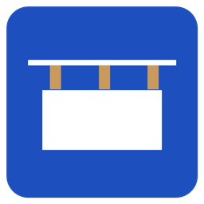

# Pinza



**Cada captura de pantalla nueva, colgada en una cuerda en el borde superior de Windows.**

Pinza vigila tu carpeta de capturas. En cuanto aparece una nueva, la cuerda baja sola y la
captura se tiende en ella con su pinza de madera. Desde ahí la copias, la anotas, la abres,
la arrastras a otra aplicación o la tiras a la papelera: sin abrir el Explorador ni buscar
nada en el escritorio.

Windows 10/11 · Gratis y de código abierto · Sin cuentas, sin red, sin telemetría

<br>

<p align="center">
  <a href="https://github.com/aam9063/Pinza/releases/latest"><b>Descargar para Windows ›</b></a>
  &nbsp;&nbsp;·&nbsp;&nbsp;
  <a href="#compilar-desde-el-código">Compilar desde el código</a>
  &nbsp;&nbsp;·&nbsp;&nbsp;
  <a href="#créditos">Créditos</a>
</p>

---

## Descarga

Coge el instalador de la [última release](https://github.com/aam9063/Pinza/releases/latest):

```
Pinza_0.1.0_x64-setup.exe
```

Abre el fichero y sigue el asistente. Windows SmartScreen avisará de que el editor no está
verificado: es esperado, la firma de código queda fuera de esta versión. Pulsa **Más
información → Ejecutar de todas formas**.

Instala por usuario, sin permisos de administrador, y no necesita nada más: el runtime de
WebView2 viene con Windows 10/11 actualizado.

<details>
<summary>Si prefieres compilarlo tú</summary>
<br>

Necesitas [Node.js](https://nodejs.org) 20 o superior, [pnpm](https://pnpm.io) 11 y el
toolchain estable de Rust con las Build Tools de Visual Studio para C++.

```sh
git clone https://github.com/aam9063/Pinza.git
cd Pinza
pnpm install
pnpm tauri build
```

El instalador aparece en `src-tauri/target/release/bundle/nsis/`. Para desarrollo con
inspección del WebView:

```sh
pnpm dev:debug
```

</details>

<br>

## Lo que hace

| Cuándo | Qué pasa |
|:--|:--|
| Tomas una captura | La cuerda baja sola y la captura se tiende en ella, la más nueva a la izquierda |
| Pasas el ratón por encima | Se endereza, sube dos píxeles y aparece su barra de acciones |
| Clic | La copia al portapapeles y te lo confirma con una pastilla «Copiada» |
| Mantienes 0,4 s | Abre el editor de anotaciones con la captura cargada |
| Doble clic | La abre con el visor predeterminado de Windows |
| La arrastras | Arrastre nativo del fichero original a una carpeta, a un chat, a un correo o a un documento |
| La tiras a la papelera | Va a la Papelera de reciclaje (o se borra, si lo cambias en Ajustes) y se descuelga de la cuerda |
| Pasas de diez | La más antigua se descuelga; el fichero **nunca** se borra por esto |

Fuera de la cuerda, la ventana deja pasar el ratón a lo que haya debajo: los clics solo
llegan a Pinza cuando el puntero está sobre una miniatura.

<br>

## La cuerda

- **Baja cuando la rozas.** Poner el puntero en el borde superior de la pantalla durante un
  instante la despliega; al retirarlo se vuelve a esconder.
- **Atajo global.** <kbd>Ctrl</kbd> + <kbd>Alt</kbd> + <kbd>T</kbd> la muestra u oculta desde
  cualquier aplicación. Se puede cambiar en Ajustes grabando otra combinación.
- **Nunca interrumpe.** Con un juego, un vídeo o una presentación a pantalla completa se
  queda escondida.
- **Vive en la bandeja.** Desde su icono abres la carpeta de capturas, pausas la vigilancia,
  entras en Ajustes o sales.

<br>

## El editor de anotaciones

Lápiz y resaltador de trazo natural, flecha, línea, rectángulo, elipse, texto y pasos
numerados que se autoincrementan. Cada anotación es un objeto: la mueves, la redimensionas,
le cambias el color o el grosor después de dibujarla, la duplicas con <kbd>Ctrl</kbd> +
<kbd>D</kbd> y la borras con <kbd>Supr</kbd>. Deshacer y rehacer sin límite durante la sesión.

Arriba tienes zoom con <kbd>Ctrl</kbd> + rueda y desplazamiento con espacio y arrastre.
Para ocultar datos sensibles están el pixelado y el difuminado, y para quedarte solo con una
zona, el recorte.

**Guardar y cerrar** escribe `captura_<fecha>_<hora>_anotada.png` junto al original y la
cuelga como captura nueva. El original no se toca nunca. El resultado se exporta a la
resolución real de la captura, no a la de tu pantalla.

<br>

## Privacidad

- **Sin red.** Pinza no hace ni una petición: ni cuentas, ni analítica, ni comprobación de
  actualizaciones.
- **Todo en tu equipo.** La lista de capturas, los ajustes y las miniaturas viven en tu
  carpeta de usuario.
- **Tus ficheros son tuyos.** El original nunca se modifica, y descolgar una captura de la
  cuerda jamás la borra del disco.

<br>

## Ajustes

Carpeta vigilada, Papelera de reciclaje o borrado definitivo, modo de despliegue (borde,
atajo o ambos), cuántas miniaturas cuelgan, ocultar en pantalla completa, atajo global e
iniciar con Windows. Todo se guarda al instante y sobrevive a los reinicios.

<br>

## Lo que viene

Este es el punto de partida, no el final:

- **Más idiomas.** La interfaz está en castellano; llegarán traducciones.
- **Corrección de fallos.** Los que vayáis encontrando se irán arreglando en cada release.
- **Detalles pendientes.** La animación de la captura viajando hasta la cuerda está a medio
  camino y volverá más afinada.

Si algo va mal, abre un issue con la versión de Windows, la de Pinza y los pasos para
reproducirlo. Se agradece mucho.

<br>

## Cómo está hecho

| Capa | Tecnología |
|:--|:--|
| Shell nativo | Tauri 2 sobre Rust estable: vigilante de ficheros, miniaturas, portapapeles, papelera, arrastre nativo y llamadas a Win32 |
| Interfaz | Next.js 16 como exportación estática, React 19 y TypeScript estricto |
| Estilos | Tailwind CSS v4 con los tokens del tema claro y oscuro |
| Animación | Motion, solo `transform` y `opacity` |
| Lienzo | Konva con perfect-freehand para los trazos |
| Pruebas | Vitest y Testing Library, `cargo test`, Playwright sobre CDP y comprobaciones estáticas (ESLint, clippy, dependency-cruiser) |

```
src/features/        cada pantalla con su lógica (line, annotate)
src/shared/          IPC tipada, motion, i18n y componentes
src-tauri/src/       watcher, shelf, thumbnails, reveal, settings, tray
```

El detalle de los flujos, el reparto entre Rust y la web y los hitos está en
[`BRIEF.md`](BRIEF.md); el mapa de features, en [`docs/feature-map.md`](docs/feature-map.md).

<br>

## Créditos

Pinza nace de una idea que no es mía: **[Tendedero](https://github.com/alejandrobujan/tendedero)**,
la app de macOS de **[Alejandro Buján](https://alejandrobujan.com)** ([@alejandr0bujan](https://x.com/alejandr0bujan))
que cuelga tus capturas en una cuerda bajo la barra de menús. Es una reinterpretación
cuidadosa para Windows, con otro stack y código propio de cero: no se ha copiado ni portado
su código, su nombre ni su icono.

Si usas Mac, pruébala: es su idea, y está muy bien hecha.

<br>

## Licencia

[MIT](LICENSE): úsalo, modifícalo, aprópiate de él y compártelo. El nombre Pinza y su icono
quedan fuera de la licencia, así que un fork necesita los suyos.
