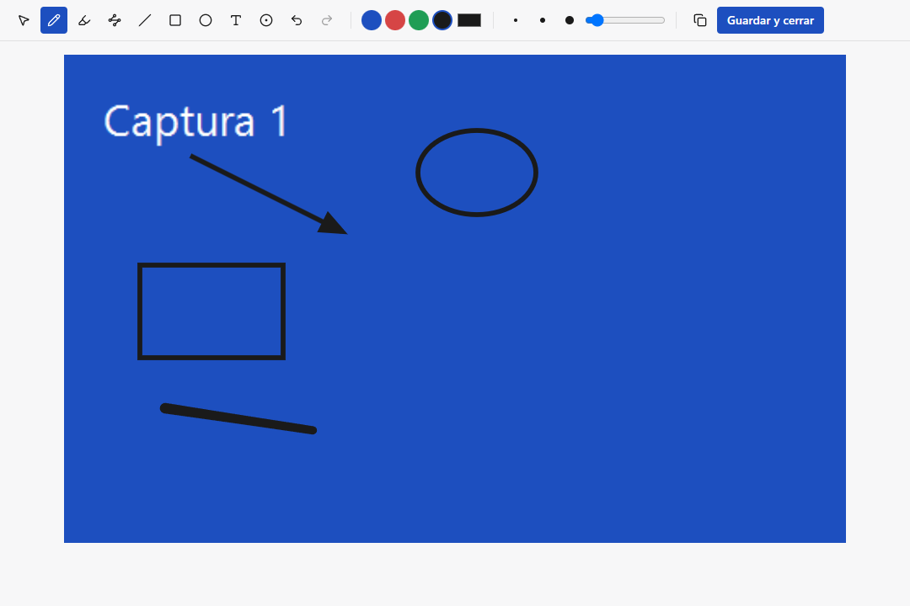
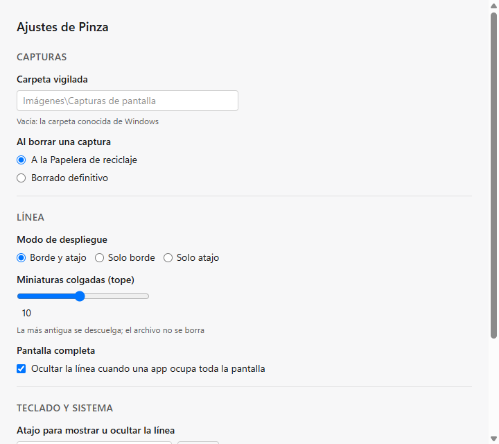

<p align="center">
  
</p>

<h1 align="center">Pinza</h1>

<p align="center">
  Tus capturas de pantalla, colgadas de una cuerda en el borde superior de Windows.<br>
  Bajan solas. Las coges sin buscar nada.
</p>


<p align="center">
  <b>Windows 10/11</b> &nbsp;·&nbsp; gratis y de código abierto &nbsp;·&nbsp; sin cuentas, sin red, sin telemetría
</p>

<p align="center">
  <a href="https://github.com/aam9063/Pinza/releases/latest">
    
  </a>
  <br>
  <sub><code>Pinza_0.1.0_x64-setup.exe</code> · 4,5 MB · sin permisos de administrador</sub>
</p>

<p align="center">
  
</p>

---

## Gracias a quien tuvo la idea

Pinza es una reinterpretación para Windows de **[Tendedero](https://github.com/alejandrobujan/tendedero)**,
la aplicación de macOS de **[Alejandro Buján](https://alejandrobujan.com)**
([@alejandr0bujan](https://x.com/alejandr0bujan)) que cuelga las capturas de una cuerda bajo
la barra de menús. La idea es suya y está muy bien llevada; si tienes un Mac, pruébala.

Aquí está hecha desde cero, con otro stack y código propio: no se ha portado ni copiado
nada de Tendedero, ni su nombre, ni su icono.

<br>

## Cómo va

**Capturas algo.** Win + Impr Pant o el Recortes, como siempre. Pinza vigila tu carpeta de
capturas y no tarda: en cuanto el PNG está completo, la cuerda baja y la captura se tiende
en ella. La más nueva queda a la izquierda, con su pinza y la etiqueta **Nueva**.

**La cuerda vive escondida.** Asoma cuando llevas el puntero al borde superior de la pantalla
o pulsas <kbd>Ctrl</kbd>+<kbd>Alt</kbd>+<kbd>T</kbd>. Al retirar el ratón vuelve a su sitio.
Con un juego, un vídeo o una presentación a pantalla completa no aparece.

**Y no estorba.** Fuera de las miniaturas, la ventana deja pasar el ratón: los clics llegan a
la aplicación que tengas debajo.

<br>

## Un gesto para cada cosa

| Gestes | Pasa |
|:--|:--|
| Clic | La copia al portapapeles. Pastilla **Copiada** durante un segundo |
| Mantener 0,4 s | Se abre el editor con esa captura dentro |
| Doble clic | Se abre con el visor de fotos de Windows |
| Arrastrar | El fichero original viaja a una carpeta, a un chat, a un correo o a un documento |
| Papelera | A la Papelera de reciclaje. La pinza se abre y la captura cae |
| Más de diez | La más antigua se descuelga. **El fichero no se borra nunca por esto** |

<br>

## El editor

<p align="center">
  
</p>

Lápiz y resaltador de trazo natural, flecha, línea, rectángulo, elipse, texto y pasos
numerados que se numeran solos. Para tapar lo que no debe verse, pixelado y difuminado. Para
quedarte con una parte, recorte.

Cada anotación sigue siendo tuya después de dibujarla: la mueves, la estiras, le cambias el
color o el grosor, la duplicas con <kbd>Ctrl</kbd>+<kbd>D</kbd> o la borras con <kbd>Supr</kbd>.
Deshacer y rehacer, sin límite, mientras trabajas.

**Guardar y cerrar** escribe una copia `..._anotada.png` junto al original, a la resolución
real de la captura, y la cuelga en la cuerda. El original se queda como estaba.

<br>

## A tu manera

<p align="center">
  
</p>

Qué carpeta vigilar, si la papelera recicla o borra de verdad, cuántas capturas cuelgan, si
la línea baja con el borde, con el atajo o con las dos cosas, si se esconde en pantalla
completa y qué combinación de teclas la llama. Todo se guarda al momento y sigue ahí tras
reiniciar.

El primer día, un asistente de tres pasos te deja esto listo y termina con la vigilancia
funcionando.

<br>

## Sin red. Sin cuentas. Sin sorpresas

Pinza no hace ni una petición: no hay cuentas, ni analítica, ni comprobación de
actualizaciones. Tus capturas, la lista de la cuerda y los ajustes se quedan en tu equipo.
Y descolgar una captura nunca la borra del disco: solo desaparece de la línea.

<br>

## Instalar

1. Descarga el instalador desde la [última release](https://github.com/aam9063/Pinza/releases/latest).
2. Ábrelo. SmartScreen avisará de que el editor no está verificado — la firma de código queda
   fuera de esta versión. **Más información → Ejecutar de todas formas**.
3. Sigue el asistente: carpeta, atajo y arranque con Windows.

<details>
<summary><b>Compilar desde el código</b></summary>
<br>

Hace falta Node.js 20 o superior, pnpm 11 y el toolchain estable de Rust con las Build Tools
de Visual Studio para C++.

```sh
git clone https://github.com/aam9063/Pinza.git
cd Pinza
pnpm install
pnpm tauri build     # instalador en src-tauri/target/release/bundle/nsis/
pnpm dev:debug       # desarrollo con inspección del WebView
```

Las comprobaciones del proyecto: `pnpm verify` (tipos, lint, pruebas, arquitectura) y
`cargo test` en `src-tauri/`.

</details>

<br>

## Lo que viene

- **Más idiomas**: ahora mismo la interfaz está en castellano.
- **Menos fallos**: cada release irá cerrando lo que vayáis encontrando.
- **La captura viajando hasta la cuerda**: la animación está a medio camino y volverá más
  afinada.

Si algo se rompe, abre un issue con tu versión de Windows, la de Pinza y cómo reproducirlo.

<br>


## Licencia

MIT License
